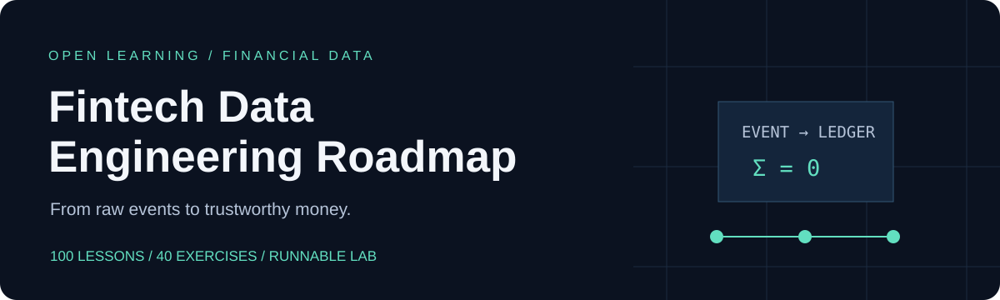

<p align="center"></p>

# Fintech Data Engineering Roadmap

**От первого SQL до объяснимого DWH в финтехе: 100 уроков, 40 заданий с проверкой и рабочая лаборатория платежей.**

[Начать обучение](docs/START_HERE.md) · [Карта из 100 уроков](roadmap/README.md) · [Практикум](practice/README.md) · [Видео](resources/VIDEOS.md) · [English](README_EN.md)

Это открытый учебный маршрут по data engineering, DWH и денежным данным. Здесь разбираем, **что учить, зачем это нужно, как реализовать принцип и как обнаружить ошибку**. Центральные темы — точные суммы, история изменений, повторная доставка, поздние события, сверка и восстановление. Есть отдельный блок про ИИ, RAG, Text-to-SQL и ML-признаки.

## Попробуй за пять минут

Требуется Python 3.12+ с модулем `sqlite3` и Git. Основная лаборатория и все 40 заданий работают на стандартной библиотеке. Команды одинаковы для PowerShell, Bash и macOS Terminal; запускай их из корня клонированного репозитория.

```bash
git clone https://github.com/antony502189-max/fintech-data-engineering-roadmap.git
cd fintech-data-engineering-roadmap
python -m fintech_lab --out work/demo
python -m unittest discover -s tests -v
python practice/run.py init E01
python practice/run.py grade E01
```

Последняя команда сначала падает: в личной копии задания находится `TODO`. Открой `work/answers/E01.py`, реализуй `solve(data)` и запусти проверку снова. На Windows, если команда `python` недоступна, используй `py -3` вместо неё.

Лаборатория создаёт `work/demo/warehouse.db` и `report.json`. В первом чистом запуске получишь:

- 6 принятых событий; повтор загрузки даёт 6 дублей и 0 новых записей.
- Daily net cash за 1 января: USD 12200 и EUR 4900 minor units; за 2 января: USD −2000.
- Две совпавшие сверки, расхождение p3 на −100 USD minor units и неожиданную внешнюю запись p9.
- Для позднего p3: исторический feature равен 0 до получения события и 2500 после.

Повтор запуска в ту же базу даёт `inserted=0, duplicates=6` уже на первом шаге. Для чистого опыта выбери новый `--out`. Учебные несовпадения в сверке сделаны намеренно.

## Что внутри

| Раздел | Результат |
|---|---|
| [100 уроков](roadmap/README.md) | Последовательность, объяснения, примеры, задания, ошибки, критерии проверки и первичные источники |
| [40 готовых заданий](practice/README.md) | 40 starters, 40 решений, 90 проверочных cases, CLI для самостоятельной работы |
| [Лаборатория](labs/README.md) | SQLite DWH, synthetic events, exact money, idempotency, ledger, reconciliation, SCD2, point-in-time features |
| [Архитектура](docs/ARCHITECTURE.md) | Путь данных, транзакционные границы и ограничения учебной реализации |
| [Материалы](resources/README.md) | YouTube, официальная документация и разборы Stripe, Monzo, Uber |
| [Capstone](projects/README.md) | Четыре самостоятельных проекта и рубрика приёмки |
| [ИИ](docs/AI_WORKFLOW.md) | Проверка SQL, доступы RAG, injection, evals и использование синтетики |
| [Эксплуатация](docs/INCIDENT_RUNBOOKS.md) | Диагностика пропущенных, поздних и неверных денежных событий |

## Маршрут

| Модуль | Темы | Практика |
|---|---|---|
| 01. База | Python, Git, тесты, API, контейнеры, время и деньги | E01–E04 |
| 02. SQL | Grain, JOIN, NULL, windows, transactions, indexes, incremental | E05–E08 |
| 03. DWH | Слои, facts, dimensions, SCD2, бивремя, Vault, метрики | E09–E12 |
| 04. Ingestion | Batch, webhooks, CDC, schema evolution, outbox, replay | E13–E16 |
| 05. Storage | Parquet, partitions, Iceberg, DWH, Spark, Kafka, event time | E17–E20 |
| 06. Transform | dbt, DAG, retries, backfill, publish, CI, migrations | E21–E24 |
| 07. Fintech | Lifecycle, ledger, reconciliation, refunds, FX, credit, fraud | E25–E28 |
| 08. Надёжность | Quality, latency, observability, incidents, backups, drills | E29–E32 |
| 09. Platform | IAM, PII, secrets, encryption, retention, IaC, FinOps | E33–E36 |
| 10. ИИ и рост | SQL assistant, RAG, injection, evals, feature store, portfolio | E37–E40 |

Новичку подойдёт [маршрут с нуля](docs/LEARNING_PATHS.md), аналитику — переход через SQL и моделирование, backend-разработчику — через delivery guarantees и историю. Первый проход всех уроков оценивается в 200–400 часов; capstone и реальный стек требуют дополнительного времени. Это ориентир, а не обещание трудоустройства.

## Проверка репозитория

```bash
python -m unittest discover -s tests -v
python practice/run.py verify
python scripts/check_docs.py
python scripts/check_sql.py
```

CI запускает проверки на Windows и Ubuntu, Python 3.12 и 3.14. `verify` проверяет эталоны, а `grade` — личное решение. Стартеры намеренно незавершённые. [Результаты локальной проверки](docs/VALIDATION.md).

## Границы и прозрачность

Вся платёжная информация синтетическая. Лаборатория упрощает accounting perspective, не моделирует банковский settlement protocol, compliance certification, реальный Kafka cluster и cloud IAM. Задания по платформе и ИИ запускают локальные симуляции принципов; [расширения стека](labs/STACK_EXTENSIONS.md) описывают дальнейшую практику. Материалы по политике хранения не устанавливают юридические сроки.

Первое издание подготовлено с помощью ИИ: код и examples проверены автоматическими проверками, внешние материалы атрибутированы. Подробности и смысл истории коммитов — в [PROVENANCE](docs/PROVENANCE.md). Даты коммитов реальные; большое число небольших изменений не означает годы разработки.

## Помочь проекту

Если пригодилось — поставь ⭐, чтобы сохранить маршрут, и покажи конкретный урок или упражнение коллегам. Особенно полезны bug reports с воспроизводимым примером, новые edge cases, исправления ссылок и English translations. Начни с [CONTRIBUTING](CONTRIBUTING.md). Для публикации на форумах есть [короткие тексты и demo](community/SHARING.md).

MIT license. Ссылки на внешние материалы не меняют их лицензии. [Источники и аналоги](resources/RESEARCH_NOTES.md).
