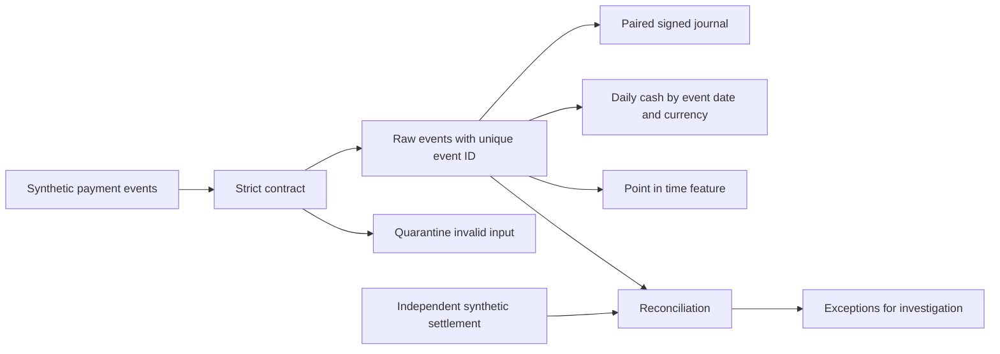

# Teaching warehouse architecture

## Data and boundaries

`synthetic.py` defines fixed inputs; there is no network. `contracts.py` validates fields and normalizes UTC timestamps. `warehouse.py` persists raw events and two postings in one SQLite transaction. Daily output is a view, not a separately materialized mart; stale physical materialization is outside the baseline.

Invalid schemas go to quarantine without postings. Identical business payloads under one event ID are duplicates despite changed delivery timestamps. A changed amount under an accepted ID raises a conflict and rolls back the batch. Accepted events are retained; business corrections need a separate model not implemented here.

## Monetary perspective

Capture produces `+processor_receivable` and `-merchant_payable`; refund reverses these signs. Fees produce `-processor_receivable` and `+processing_expense`. This signed teaching model does not define a real business's chart of accounts.

`assert_balanced` checks zero sums and two postings per event/currency, plus raw events lacking a journal. Independent reconciliation compares payment/currency net against external fixtures. Balanced wrong amounts can pass conservation but fail reconciliation.

## Time and history

The mart groups UTC event dates. e6 arrives January 3 but belongs to January 1. The view computes current results on reading; physical incremental updates are a separate exercise.

`scd.py` maintains valid intervals [from,to); late changes split intervals. It replaces prior knowledge and is not bitemporal audit. `features.py` requires event_time < decision_at and received_at <= decision_at, illustrating knowledge-time constraints for immutable events.

| Scenario | Behavior |
|---|---|
| Same ID and business payload | Duplicate, no extra money |
| Same ID and different amount | Conflict, batch rollback |
| Missing field or wrong type | Row quarantine |
| Exception before batch commit | New batch writes roll back |
| Late event | Original business date retained |
| Missing external payment | Exception, not a confirmed zero |

## Untested boundaries

No HTTP receiver, signatures, Kafka offsets, distributed checkpoints, production IAM, encryption configuration, PCI scope, bank settlement, or physical marts are implemented. Refunds can arrive without capture; cumulative-refund checks are not built in. FX, credit, and AI policies are exercises and capstones.

SQLite has its own typing and transaction behavior. Porting needs dialect, overflow, concurrency, and publication checks. Continue with [stack extensions](../labs/STACK_EXTENSIONS.md).
