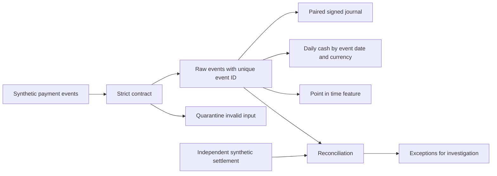

# Архитектура учебного DWH

## Данные и границы

`synthetic.py` предоставляет фиксированные fixtures; network отсутствует. `contracts.py` проверяет поля и UTC timestamps. `warehouse.py` в одной SQLite transaction сохраняет принятый raw event и две signed postings. `daily` читает view: данные не копируются в отдельную физическую mart, поэтому stale materialization в основной lab не моделируется.

Invalid schema сохраняется в quarantine и не создаёт проводки. Одинаковый event_id с одинаковым business payload считается duplicate, даже если delivery timestamp отличается. Одинаковый event_id с иной суммой вызывает exception и откат текущей партии. Оригинальные принятые события сохраняются; corrections должны приходить отдельной моделью событий, которая здесь не реализована.

## Денежная модель

Capture создаёт `+processor_receivable` и `-merchant_payable`. Refund меняет эти знаки. Fee создаёт `-processor_receivable` и `+processing_expense`. Это упрощённая signed модель для объяснения balance; она не определяет план счетов реального бизнеса.

`assert_balanced` проверяет sum=0 и две postings по event/currency, а также отсутствие raw events без journal. Финансовая сверка независимо сравнивает payment/currency net с external fixture. Сбалансированная неверная сумма может пройти ledger check и провалить reconciliation.

## Время и история

Денежная mart группирует по UTC event_date. Late e6 приходит 3 января, относится к 1 января и учитывается там. View пересчитывает результат при чтении; incremental update exercise описывает отдельную физическую реализацию.

`scd.py` хранит valid-time intervals [from,to). Late change разрезает соседние интервалы. Старое знание о корректировке не сохраняется: это **SCD2 valid-time**, не bitemporal audit. `features.py` проверяет event_time < decision_at и received_at <= decision_at; он иллюстрирует защиту от знания будущего для неизменяемых событий.

## Повтор и сбой

| Сценарий | Результат |
|---|---|
| Same ID, same payload | Duplicate; нет новых денег |
| Same ID, different amount | Conflict; rollback batch |
| Missing field или wrong type | Quarantine row |
| Exception после новых вставок до commit | Новые вставки batch откатываются |
| Late event | Business date остаётся исходной |
| Missing external payment | Отдельная exception, не ноль |

## Чего реализация не доказывает

Нет HTTP receiver, реальной signature verification, Kafka offsets, distributed checkpointing, production IAM, encryption configuration, real PCI scope, независимого банковского settlement и materialized marts. Refund может прийти без capture, cumulative refund validation не встроен. Полный ledger chart, FX, credit и AI policies вынесены в упражнения и capstone.

SQLite имеет собственные typing и transaction semantics. Перенос в PostgreSQL, dbt или lakehouse требует проверки dialect, decimal overflow, concurrency и publish guarantees. Практическое продолжение — [Stack extensions](../labs/STACK_EXTENSIONS.md).
